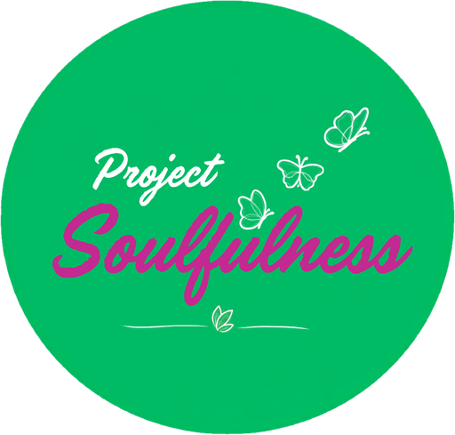

<div align="center">



# Project Soulfulness

**Good People. Better Days.**

The official website of Project Soulfulness — a garden café and social-wellness community in Madhapur, Hyderabad.


</div>

---

## Table of contents

- [About](#about)
- [Features](#features)
- [Tech stack](#tech-stack)
- [Getting started](#getting-started)
- [Project structure](#project-structure)
- [Managing content](#managing-content)
- [SEO](#seo)
- [Deployment](#deployment)
- [Roadmap](#roadmap)
- [License](#license)

## About

Project Soulfulness is a non-clinical social-wellness space — part coffee shop, part community sanctuary — where young people can unwind, connect and find balance. This repository contains its marketing website: a fast, mostly static Next.js site that introduces the space, its experiences and events, and publishes a blog.

**Experiences featured:** café & coffee raving · French bulldog companionship · travel cluster · jamming sessions · stand-up comedy · curated healthy menu · inspirational talks · weekend workshops.

## Features

- **Animated hero** — a swipeable photo stack and an orbit of experience photos circling the logo.
- **Home page sections** — About, Experiences, Who We Serve, Positioning, Events and the latest blog posts.
- **Blog ("The Soulful Journal")** — statically generated articles, each with its own SEO metadata.
- **Events with a launch switch** — show a "Coming soon" preview or the full calendar by changing one setting.
- **Contact page** — contact details, a Google Maps link and a message form that opens the visitor's email client (no backend required).
- **Brand touches** — an intro splash animation, flying butterflies, drifting leaves and a butterfly cursor.
- **Responsive and accessible** — mobile-first layouts, keyboard-friendly controls, image alt text, and reduced-motion support for all animations.
- **Content-driven** — nearly all copy, images and data live in two TypeScript files.

## Tech stack

| Area | Technology |
|---|---|
| Framework | [Next.js 16](https://nextjs.org/) (App Router, static generation) |
| UI | [React 19](https://react.dev/) |
| Language | [TypeScript 5](https://www.typescriptlang.org/) |
| Styling | [Tailwind CSS 4](https://tailwindcss.com/) + custom CSS animations |
| Icons | [lucide-react](https://lucide.dev/) |
| Fonts | Outfit, Lora, Caveat, Dancing Script (via `next/font/google`) |
| Linting | ESLint (`eslint-config-next`) |

## Getting started

### Prerequisites

- [Node.js](https://nodejs.org/) **20.9 or later**
- npm (bundled with Node.js)

### Installation

```bash
git clone https://github.com/G-sai-mukesh/Project_soulfulness.git
cd Project_soulfulness
npm install
npm run dev
```

Open [http://localhost:3000](http://localhost:3000) in your browser.

### Available scripts

| Command | Description |
|---|---|
| `npm run dev` | Start the development server with hot reload |
| `npm run build` | Create an optimised production build |
| `npm run start` | Serve the production build locally |
| `npm run lint` | Run ESLint across the project |

## Project structure

```
Project_soulfulness/
├── public/
│   └── images/                 Photos and logo
├── src/
│   ├── app/                    Routes (Next.js App Router)
│   │   ├── page.tsx            Home page
│   │   ├── blog/               Blog listing and [slug] article pages
│   │   ├── events/             Events page
│   │   ├── contact/            Contact page
│   │   ├── layout.tsx          Root layout, fonts and site-wide metadata
│   │   ├── globals.css         Brand tokens and animations
│   │   ├── sitemap.ts          Generated sitemap.xml
│   │   └── robots.ts           Generated robots.txt
│   ├── components/             UI components (one per page section)
│   └── lib/
│       ├── content.ts          Site copy and data
│       ├── blogs.ts            Blog posts
│       └── useReveal.ts        Scroll-reveal animation hook
├── next.config.ts
└── package.json
```

### Routes

| Route | Description |
|---|---|
| `/` | Home |
| `/blog` | Blog listing |
| `/blog/[slug]` | Blog article (statically generated) |
| `/events` | Events — "Coming soon" preview or full calendar |
| `/contact` | Contact details and message form |

## Managing content

Content is separated from layout, so most updates don't require touching any component.

### Site content — `src/lib/content.ts`

| Export | Controls |
|---|---|
| `navLinks` | Navbar and footer links |
| `heroGallery` | Hero photo stack images and captions |
| `heroPillars` | The four highlights in the About section |
| `problemSolutionPromise` | Problem / Solution / Promise cards |
| `experiences` | Experience cards (`image`) and hero orbit photos (`orbitImage`) |
| `audiencePoints` | "Who We Serve" list |
| `eventsLive` / `events` | Events launch switch and event list |
| `testimonials` | Member reviews |
| `contact` / `siteUrl` | Email, phone, address, map link and production domain |

### Blog posts — `src/lib/blogs.ts`

Add an entry to `blogPosts` and the blog listing, the article page, the home page's "Recent Blogs" section and the sitemap all update automatically. Each post supports a title, excerpt (used as the meta description), category, date, read time, cover image, keywords and a body made of paragraphs, headings, lists and quotes.

> Keep cover images under ~1600px wide and a few hundred KB — images are served as-is.

### Launching events

Events are hidden behind a switch until the calendar is ready:

```ts
// src/lib/content.ts
export const eventsLive = false; // true → show dates, times and booking
```

Update the event dates before switching it on.

## SEO

- Per-page titles, descriptions, canonical URLs and Open Graph / Twitter preview images
- Structured data (JSON-LD): local business, blog articles and events
- Auto-generated `sitemap.xml` and `robots.txt`
- Location-focused keywords for local search in Hyderabad

Set `siteUrl` in `src/lib/content.ts` to the production domain so canonical URLs and the sitemap are correct.

## Deployment

The site can be deployed to any platform that supports Next.js, such as [Vercel](https://vercel.com/new):

1. Import the repository.
2. Keep the default build command (`npm run build`).
3. Deploy, then point the custom domain at the project.

After the first deploy, submit `https://<your-domain>/sitemap.xml` in [Google Search Console](https://search.google.com/search-console).

## Roadmap

- [ ] Publish real member testimonials (the section is ready but hidden)
- [ ] Switch on the events calendar
- [ ] Upgrade to the latest Next.js 16.x release
- [ ] Add security headers in `next.config.ts`

## License

© Project Soulfulness. All rights reserved. This repository is not licensed for reuse or redistribution.
